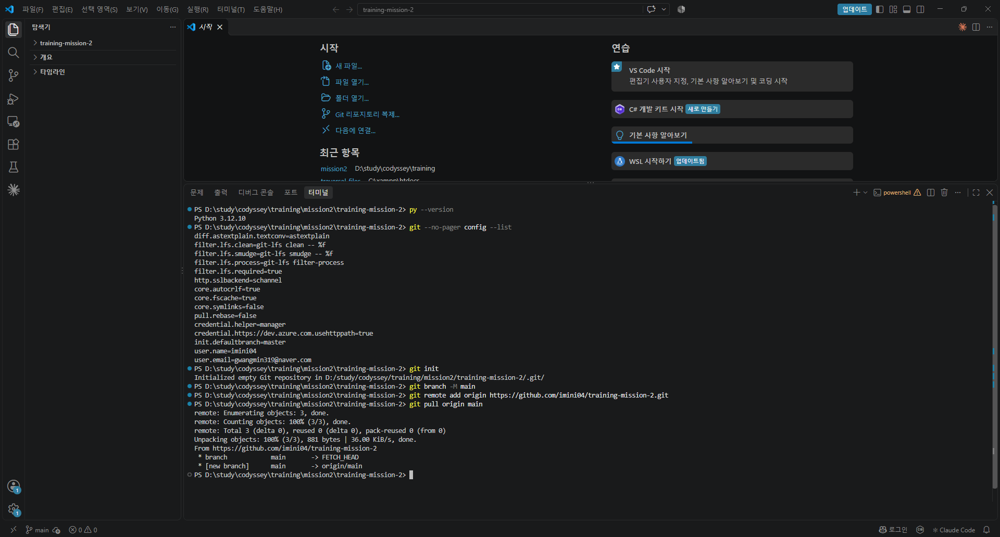
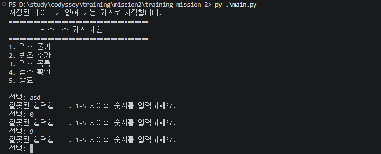
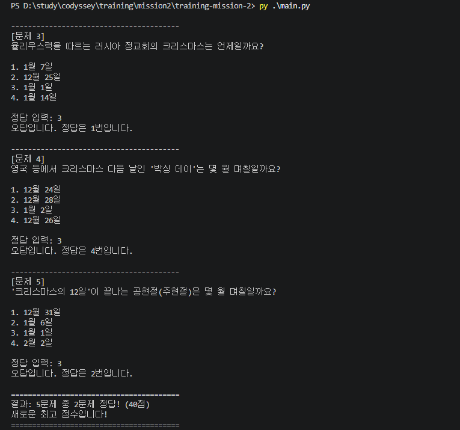
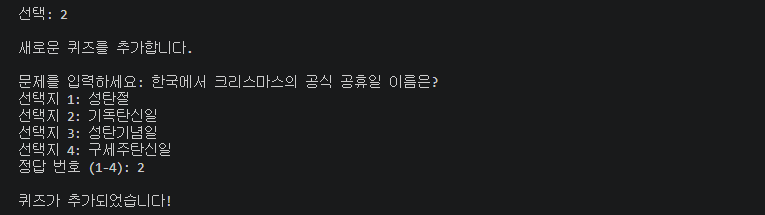
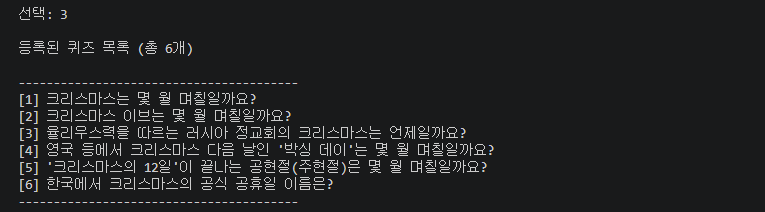
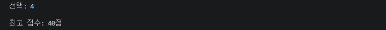
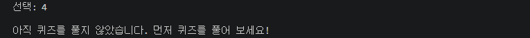

# 🎄 크리스마스 퀴즈 게임

터미널에서 동작하는 Python 콘솔 퀴즈 게임입니다.
메뉴에서 번호를 골라 퀴즈를 풀고, 새 퀴즈를 추가하고, 목록과 최고 점수를 확인할 수 있습니다.
추가한 퀴즈와 최고 점수는 `state.json`에 저장되어 프로그램을 다시 실행해도 유지됩니다.

## 프로젝트 개요

- Python 기본 문법과 표준 라이브러리만 사용 (외부 라이브러리 없음)
- `Quiz`, `QuizGame` 두 클래스로 역할을 분리한 객체 지향 구조
- JSON 파일 저장으로 데이터 영속성 구현
- 잘못된 입력, Ctrl+C, 손상된 데이터 파일에도 비정상 종료하지 않도록 예외 처리

## 퀴즈 주제와 선정 이유

**주제: 크리스마스와 관련된 날짜**

크리스마스는 누구나 아는 날이지만, 크리스마스 이브·박싱 데이·공현절처럼 그 앞뒤로 이어지는 날짜나
나라마다 다른 크리스마스(러시아 정교회는 1월 7일)는 의외로 잘 모릅니다.
날짜 문제는 정답이 하나로 분명해서 4지선다 퀴즈로 만들기 좋고, 연말 분위기에도 어울려 이 주제를 골랐습니다.

## 실행 방법

Python 3.10 이상이 필요합니다.

```bash
git clone https://github.com/imini04/training-mission-2.git
cd training-mission-2
python main.py
```

Windows에서 `python` 명령이 동작하지 않으면 `py main.py`로 실행합니다.

## 기능 목록

| 번호 | 기능 | 설명 |
|---|---|---|
| 1 | 퀴즈 풀기 | 저장된 퀴즈를 순서대로 출제하고 정답/오답과 최종 점수(100점 만점)를 보여줍니다. 최고 점수를 넘으면 갱신합니다. |
| 2 | 퀴즈 추가 | 문제, 선택지 4개, 정답 번호(1~4)를 입력받아 새 퀴즈를 등록하고 바로 저장합니다. |
| 3 | 퀴즈 목록 | 등록된 퀴즈의 문제를 번호와 함께 보여줍니다. |
| 4 | 점수 확인 | 최고 점수를 보여줍니다. 아직 풀지 않았다면 안내 메시지를 출력합니다. |
| 5 | 종료 | 데이터를 저장하고 프로그램을 종료합니다. |

### 입력 및 예외 처리

- 입력 앞뒤 공백은 제거한 뒤 처리합니다.
- 빈 입력, 숫자가 아닌 입력(`abc`), 범위 밖 숫자(메뉴 `9`, 정답 `0`)는 안내 메시지를 출력하고 다시 입력받습니다.
- 퀴즈 추가 시 문제나 선택지를 비워 두면 다시 입력받습니다.
- 퀴즈가 하나도 없으면 풀기·목록에서 안내 메시지를 출력합니다.
- 실행 중 `Ctrl+C`나 입력 종료(EOF)가 발생하면 현재 데이터를 저장한 뒤 안전하게 종료합니다.

## 파일 구조

```
training-mission-2/
├── main.py            # 실행 진입점, Ctrl+C/EOF 처리
├── game.py            # QuizGame 클래스: 메뉴, 입력 처리, 게임 진행, 저장/불러오기
├── quiz.py            # Quiz 클래스: 문제 하나(문제, 선택지, 정답)와 출력·채점·변환
├── data.py            # 기본 크리스마스 퀴즈 5개
├── state.json         # 실행 시 자동 생성되는 데이터 파일 (Git 추적 제외)
├── docs/
│   └── screenshots/   # 실행 화면 캡처
├── .gitignore
└── README.md
```

### 클래스 구성

- **`Quiz`** (`quiz.py`)
  - 속성: `question`(문제), `choices`(선택지 4개), `answer`(정답 번호 1~4)
  - 메서드: `display()` 문제 출력, `is_correct()` 정답 확인, `to_dict()` / `from_dict()` JSON 저장용 변환
- **`QuizGame`** (`game.py`)
  - 속성: `quizzes`(퀴즈 목록), `best_score`(최고 점수), `state_file`(저장 경로)
  - 메서드
    - 실행/메뉴: `run()`, `show_menu()`
    - 입력 처리: `get_number()`, `get_text()`
    - 게임 기능: `play_quiz()`, `ask_question()`, `show_result()`, `update_best_score()`, `add_quiz()`, `list_quizzes()`, `show_score()`
    - 저장/불러오기: `load_state()`, `save_state()`, `reset_to_default()`

## 데이터 파일 설명 (state.json)

- **경로**: 프로젝트 루트의 `state.json` (`game.py`와 같은 폴더)
- **역할**: 퀴즈 목록과 최고 점수를 저장해, 프로그램을 종료하고 다시 실행해도 데이터가 유지되게 합니다.
- **인코딩**: UTF-8 (`ensure_ascii=False`로 한글을 그대로 저장)
- **저장 시점**: 퀴즈 추가 시, 최고 점수 갱신 시, 프로그램 종료 시(Ctrl+C 포함)

### 스키마

```json
{
    "quizzes": [
        {
            "question": "크리스마스는 몇 월 며칠일까요?",
            "choices": ["12월 24일", "12월 25일", "12월 31일", "1월 1일"],
            "answer": 2
        }
    ],
    "best_score": 40
}
```

| 키 | 타입 | 설명 |
|---|---|---|
| `quizzes` | list | 퀴즈 목록 |
| `quizzes[].question` | str | 문제 |
| `quizzes[].choices` | list[str] | 선택지 4개 |
| `quizzes[].answer` | int | 정답 번호 (1~4) |
| `best_score` | int 또는 null | 최고 점수 (0~100점), 아직 풀지 않았으면 `null` |

### 파일이 없거나 손상된 경우

- **파일이 없을 때(첫 실행)**: 기본 퀴즈 5개로 시작하고 `state.json`을 새로 만듭니다.
- **손상되었을 때**: JSON 문법 오류, 필요한 키 누락, 선택지 개수나 정답 번호가 잘못된 경우 안내 메시지를 출력하고 기본 퀴즈 데이터로 복구합니다.
- **읽기/쓰기 오류**: 안내 메시지를 출력하고 프로그램은 계속 실행됩니다.

`state.json`은 실행할 때마다 내용이 바뀌는 개인 데이터라 `.gitignore`로 Git 추적에서 제외했습니다.

## 실행 화면

### 개발 환경


### 메뉴 및 잘못된 입력 처리


### 퀴즈 풀기


### 퀴즈 추가


### 퀴즈 목록


### 점수 확인



## Git 실습 기록

- 이 문단은 저장소를 별도 폴더(`training-mission-2-clone`)에 clone한 뒤 추가하고 push했습니다.
- 원래 작업 폴더에서는 `git pull`로 이 변경사항을 받아왔습니다.