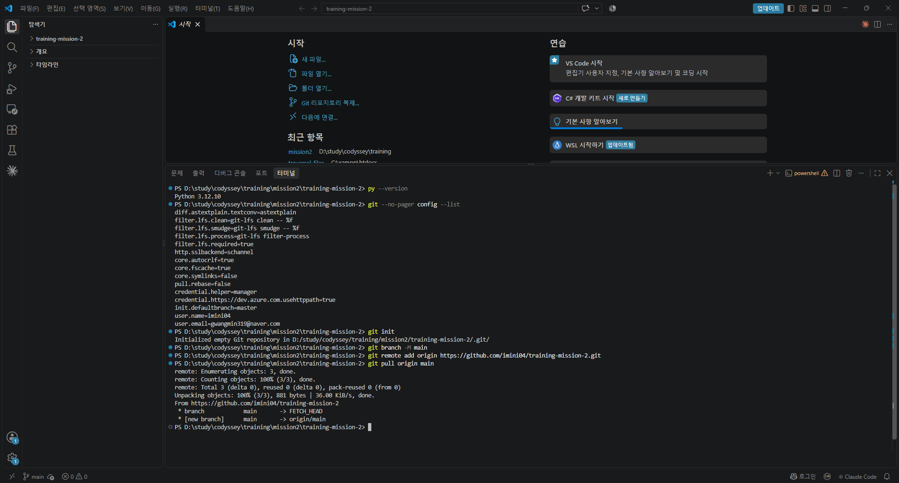
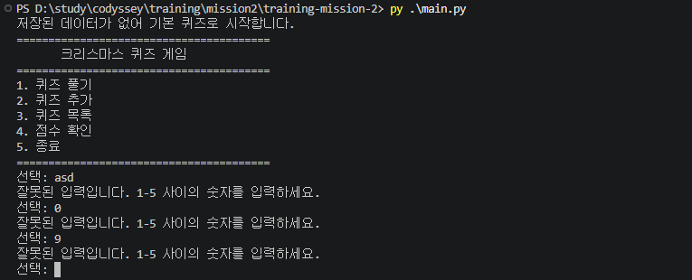
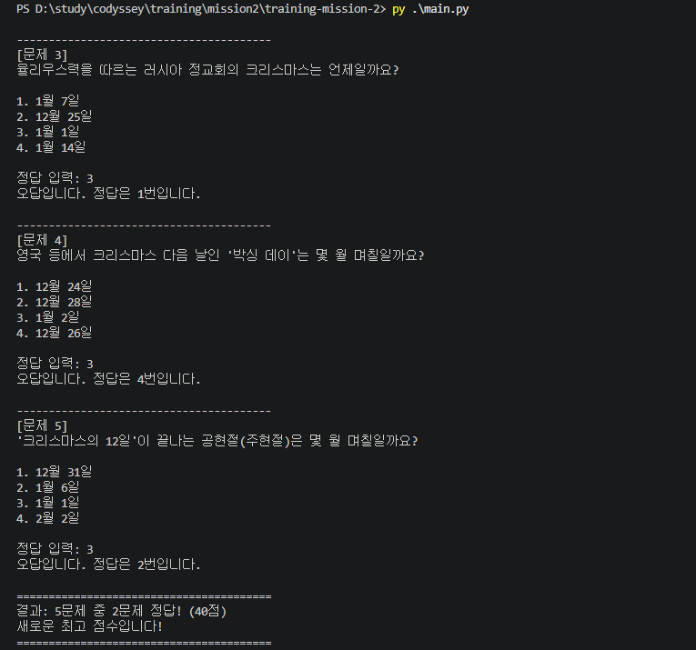
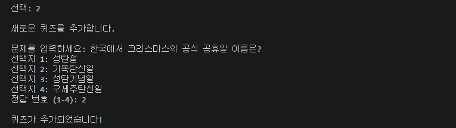
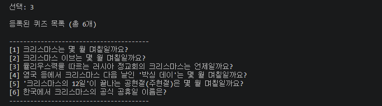
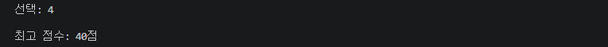
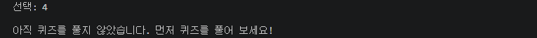
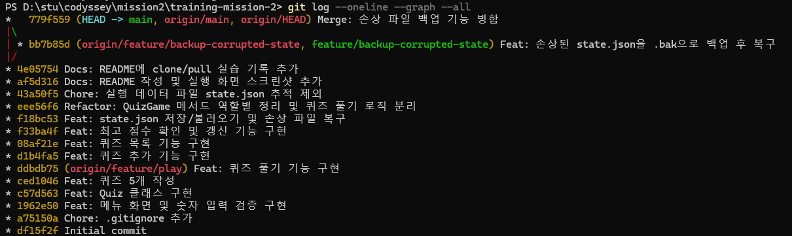

# 🎄 크리스마스 퀴즈 게임

터미널에서 동작하는 Python 콘솔 퀴즈 게임입니다.
메뉴에서 번호를 골라 퀴즈를 풀고, 새 퀴즈를 추가하고, 목록과 최고 점수를 확인할 수 있습니다.
추가한 퀴즈와 최고 점수는 `state.json`에 저장되어 프로그램을 다시 실행해도 유지됩니다.

## 프로젝트 개요

- Python 기본 문법과 표준 라이브러리만 사용 (외부 라이브러리 없음)
- `Quiz`, `QuizGame` 두 클래스로 역할을 분리한 객체 지향 구조
- JSON 파일 저장으로 데이터 영속성 구현
- 잘못된 입력, Ctrl+C, 손상된 데이터 파일에도 비정상 종료하지 않도록 예외 처리

## 퀴즈 주제와 선정 이유

**주제: 크리스마스와 관련된 날짜**

크리스마스는 누구나 아는 날이지만, 크리스마스 이브·박싱 데이·공현절처럼 그 앞뒤로 이어지는 날짜나
나라마다 다른 크리스마스(러시아 정교회는 1월 7일)는 의외로 잘 모릅니다.
날짜 문제는 정답이 하나로 분명해서 4지선다 퀴즈로 만들기 좋고, 연말 분위기에도 어울려 이 주제를 골랐습니다.

## 실행 방법

Python 3.10 이상이 필요합니다.

```bash
git clone https://github.com/imini04/training-mission-2.git
cd training-mission-2
python main.py
```

Windows에서 `python` 명령이 동작하지 않으면 `py main.py`로 실행합니다.

## 기능 목록

| 번호 | 기능 | 설명 |
|---|---|---|
| 1 | 퀴즈 풀기 | 저장된 퀴즈를 순서대로 출제하고 정답/오답과 최종 점수(100점 만점)를 보여줍니다. 최고 점수를 넘으면 갱신합니다. |
| 2 | 퀴즈 추가 | 문제, 선택지 4개, 정답 번호(1~4)를 입력받아 새 퀴즈를 등록하고 바로 저장합니다. |
| 3 | 퀴즈 목록 | 등록된 퀴즈의 문제를 번호와 함께 보여줍니다. |
| 4 | 점수 확인 | 최고 점수를 보여줍니다. 아직 풀지 않았다면 안내 메시지를 출력합니다. |
| 5 | 종료 | 데이터를 저장하고 프로그램을 종료합니다. |

### 입력 및 예외 처리

- 입력 앞뒤 공백은 제거한 뒤 처리합니다.
- 빈 입력, 숫자가 아닌 입력(`abc`), 범위 밖 숫자(메뉴 `9`, 정답 `0`)는 안내 메시지를 출력하고 다시 입력받습니다.
- 퀴즈 추가 시 문제나 선택지를 비워 두면 다시 입력받습니다.
- 퀴즈가 하나도 없으면 풀기·목록에서 안내 메시지를 출력합니다.
- 실행 중 `Ctrl+C`나 입력 종료(EOF)가 발생하면 현재 데이터를 저장한 뒤 안전하게 종료합니다.

## 파일 구조

```
training-mission-2/
├── main.py            # 실행 진입점, Ctrl+C/EOF 처리
├── game.py            # QuizGame 클래스: 메뉴, 입력 처리, 게임 진행, 저장/불러오기
├── quiz.py            # Quiz 클래스: 문제 하나(문제, 선택지, 정답)와 출력·채점·변환
├── data.py            # 기본 크리스마스 퀴즈 5개
├── state.json         # 실행 시 자동 생성되는 데이터 파일 (Git 추적 제외)
├── docs/
│   └── screenshots/   # 실행 화면 캡처
├── .gitignore
└── README.md
```

### 클래스 구성

- **`Quiz`** (`quiz.py`)
  - 속성: `question`(문제), `choices`(선택지 4개), `answer`(정답 번호 1~4)
  - 메서드: `display()` 문제 출력, `is_correct()` 정답 확인, `to_dict()` / `from_dict()` JSON 저장용 변환
- **`QuizGame`** (`game.py`)
  - 속성: `quizzes`(퀴즈 목록), `best_score`(최고 점수), `state_file`(저장 경로)
  - 메서드
    - 실행/메뉴: `run()`, `show_menu()`
    - 입력 처리: `get_number()`, `get_text()`
    - 게임 기능: `play_quiz()`, `ask_question()`, `show_result()`, `update_best_score()`, `add_quiz()`, `list_quizzes()`, `show_score()`
    - 저장/불러오기: `load_state()`, `save_state()`, `reset_to_default()`

## 데이터 파일 설명 (state.json)

- **경로**: 프로젝트 루트의 `state.json` (`game.py`와 같은 폴더)
- **역할**: 퀴즈 목록과 최고 점수를 저장해, 프로그램을 종료하고 다시 실행해도 데이터가 유지되게 합니다.
- **인코딩**: UTF-8 (`ensure_ascii=False`로 한글을 그대로 저장)
- **저장 시점**: 퀴즈 추가 시, 최고 점수 갱신 시, 프로그램 종료 시(Ctrl+C 포함)

### 스키마

```json
{
    "quizzes": [
        {
            "question": "크리스마스는 몇 월 며칠일까요?",
            "choices": ["12월 24일", "12월 25일", "12월 31일", "1월 1일"],
            "answer": 2
        }
    ],
    "best_score": 40
}
```

| 키 | 타입 | 설명 |
|---|---|---|
| `quizzes` | list | 퀴즈 목록 |
| `quizzes[].question` | str | 문제 |
| `quizzes[].choices` | list[str] | 선택지 4개 |
| `quizzes[].answer` | int | 정답 번호 (1~4) |
| `best_score` | int 또는 null | 최고 점수 (0~100점), 아직 풀지 않았으면 `null` |

### 파일이 없거나 손상된 경우

- **파일이 없을 때(첫 실행)**: 기본 퀴즈 5개로 시작하고 `state.json`을 새로 만듭니다.
- **손상되었을 때**: JSON 문법 오류, 필요한 키 누락, 선택지 개수나 정답 번호가 잘못된 경우 안내 메시지를 출력하고 기본 퀴즈 데이터로 복구합니다.
- **읽기/쓰기 오류**: 안내 메시지를 출력하고 프로그램은 계속 실행됩니다.

`state.json`은 실행할 때마다 내용이 바뀌는 개인 데이터라 `.gitignore`로 Git 추적에서 제외했습니다.

## 실행 화면

### 개발 환경


### 메뉴 및 잘못된 입력 처리


### 퀴즈 풀기


### 퀴즈 추가


### 퀴즈 목록


### 점수 확인



### Git 커밋 그래프


## 설계 및 개발 방식

### 클래스를 사용한 이유
`Quiz`는 문제 하나의 데이터(문제, 선택지, 정답)와 출력·채점·JSON 변환을 한 곳에 묶고, `QuizGame`은 게임 전체의 상태(퀴즈 목록, 최고 점수, 저장 경로)와 흐름을 관리합니다.
함수만으로 만들면 이 값들을 인자로 계속 넘기거나 전역 변수로 두어야 하는데, 클래스로 묶으면 `self`로 공유되어 코드의 책임 위치가 분명해지고, 기능 변경 시 수정할 곳이 줄어듭니다.
책임을 "문제 하나"와 "게임 전체"로 나눠서, 문제 형식이 바뀌면 `Quiz`를, 게임 규칙이 바뀌면 `QuizGame`을 고치면 됩니다.

### 로직 분리 기준
입력 검증(`get_number`, `get_text`), 게임 진행(`play_quiz`, `ask_question`, `show_result`), 파일 입출력(`load_state`, `save_state`)을 메서드로 나눠 각자 한 가지 일만 하게 했습니다.
특히 입력 검증을 따로 빼서 메뉴, 정답, 퀴즈 추가에서 같은 코드를 재사용합니다.

### JSON 저장 방식과 한계
JSON은 텍스트라 사람이 읽고 고칠 수 있고, 파이썬의 `dict`/`list`와 구조가 비슷해 변환이 쉬우며 표준 라이브러리만으로 쓸 수 있어 선택했습니다.
다만 퀴즈가 1000개 이상으로 늘어나면 저장할 때마다 파일 전체를 다시 쓰고 시작할 때 전부 메모리에 올려야 해서 느려지고, 일부만 검색·수정하기 어렵습니다.
또한 쓰는 도중 프로그램이 중단되면 파일이 깨질 수 있습니다. 이 경우 임시 파일에 먼저 쓴 뒤 교체하는 방식이나 sqlite 같은 DB로 바꾸는 것이 대안입니다.

### state.json 필드 설계
- `quizzes`: 퀴즈마다 문제, 선택지 여러 개, 정답이 있어 리스트 안에 딕셔너리를 두는 중첩 구조로 설계했습니다.
- `answer`: 사용자가 입력하는 번호(1~4)를 그대로 저장해 변환 없이 비교합니다.
- `best_score`: 아직 퀴즈를 풀지 않은 상태를 `null`로 구분하기 위해 null을 허용합니다.

### 파일 로딩 실패 시 처리 순서
1. 파일이 없으면 기본 퀴즈 5개로 시작하고 `state.json`을 새로 만듭니다.
2. JSON 문법 오류나 형식 오류면 안내 메시지를 출력합니다.
3. 손상된 파일을 `state.json.bak`으로 옮겨 보존합니다. 백업은 하나만 유지하고, 새로 손상되면 기존 백업을 교체합니다.
4. 기본 퀴즈 데이터로 복구하고 새 `state.json`을 저장합니다.
5. 읽기/쓰기 권한 오류는 안내 메시지만 출력하고 프로그램은 계속 실행합니다.

### 요구사항이 바뀔 때 수정 순서
- 점수 계산 방식: `game.py`의 `play_quiz()`를 먼저 수정합니다.
- 선택지 개수: `quiz.py`의 `from_dict()` 검증, `game.py`의 `add_quiz()`와 `ask_question()`의 범위를 함께 수정하고, 기존 `state.json`과 README도 맞춥니다.

### 커밋 규칙
기능 하나당 커밋 하나로 나누고, 메시지 앞에 작업 종류를 붙였습니다.

| 접두어 | 의미 | 예 |
|---|---|---|
| `Feat:` | 새 기능 | `Feat: 퀴즈 추가 기능 구현` |
| `Fix:` | 버그 수정 | (버그 수정 커밋 없음) |
| `Docs:` | 문서 수정 | `Docs: README 작성 및 실행 화면 스크린샷 추가` |
| `Refactor:` | 동작 변경 없는 구조 정리 | `Refactor: QuizGame 메서드 역할별 정리` |
| `Chore:` | 설정·기타 | `Chore: .gitignore 추가` |

### 브랜치 전략
`main`은 항상 실행 가능한 상태로 두고, 새 기능은 별도 브랜치에서 작업한 뒤 완성되면 `main`에 병합(merge)합니다.
- `feature/play`: 퀴즈 풀기 기능 개발 후 `main`에 병합 (fast-forward)
- `feature/backup-corrupted-state`: 손상 파일 백업 기능 개발 후 `main`에 `--no-ff`로 병합 (병합 커밋 `779f559`)

### 커밋 수 증빙
총 17개 이상의 커밋이 있습니다. (아래는 `git log --oneline --graph --all` 일부)

```
*   779f559 Merge: 손상 파일 백업 기능 병합
|\
| * bb7b85d Feat: 손상된 state.json을 .bak으로 백업 후 복구
|/
* 4e05754 Docs: README에 clone/pull 실습 기록 추가
* af5d316 Docs: README 작성 및 실행 화면 스크린샷 추가
...
* df15f2f Initial commit
```

## Git 실습 기록

- 이 문단은 저장소를 별도 폴더(`training-mission-2-clone`)에 clone한 뒤 추가하고 push했습니다.
- 원래 작업 폴더에서는 `git pull`로 이 변경사항을 받아왔습니다.